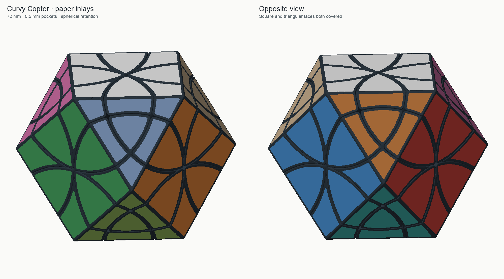
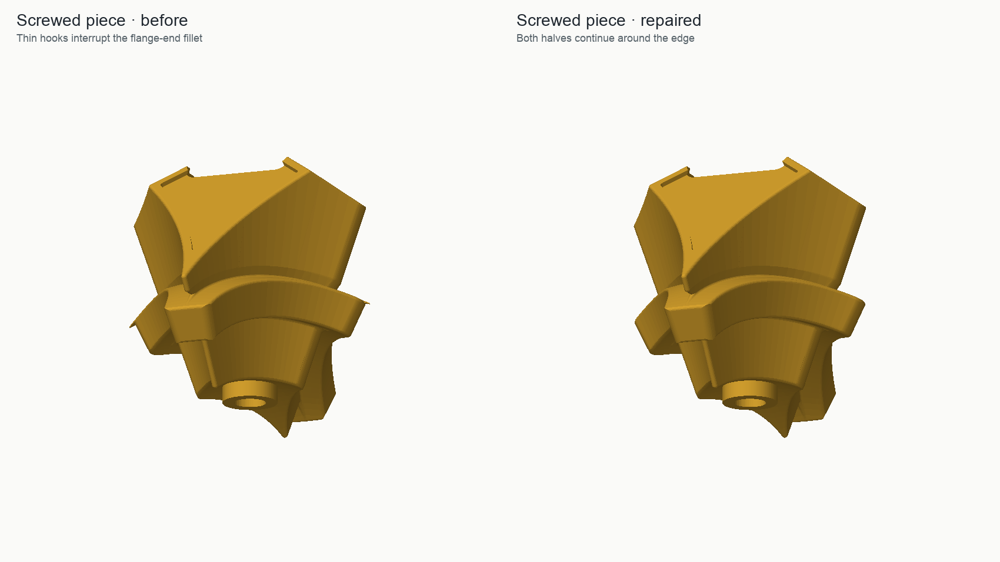
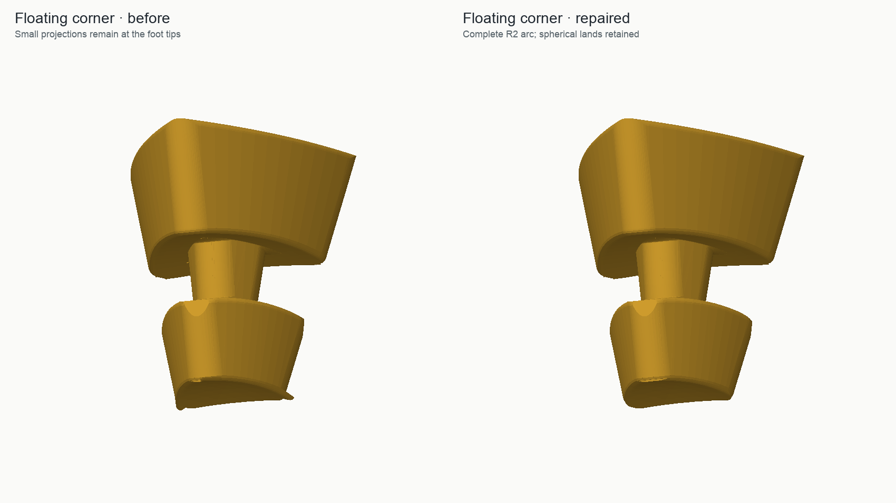
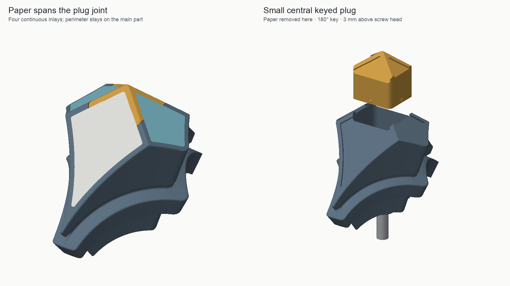
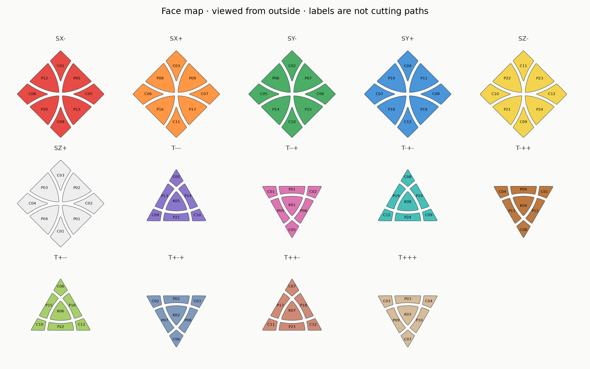

# Curvy Copter cuboctahedron — laminated-paper inlays, v4.1

A natural cuboctahedron with twelve 45° corner-turning cuts, ordinary 180° turns and Curvy Copter jumbling. The square-face spacing is **72 mm**. Both the six square faces and eight triangular faces have **0.5 mm deep pockets**. Twelve small, positively keyed plugs cover the screws and carry the central sections of the inlay pockets.

**Rounding correction:** this package completes both halves of the R2 edge fillets on the screwed pieces and floating corners, removing the thin hook remnants. If you already printed v4, only the **12 screwed centers and 8 floating corners** change. Petals, core, plugs and all paper cutting outlines remain compatible and need no reprint/re-cut. Pocket contours are preserved exactly.

## What to print

**Reuse the core from the spherical-retention Curvy Copter cuboctahedron.** The included core STL is byte-identical to that proven core. This is the twelve-axis Curvy Copter, not the fourteen-axis face-turning cuboctahedron or its rhombic-dodecahedron dual.

| STL in `stl/puzzle/` | Quantity | Purpose |
|---|---:|---|
| `axial-center-print-12.stl` | 12 | Screwed vertex pieces, with paper pockets and keyed sockets |
| `petal-print-24.stl` | 24 | Petals, each with a square-face and triangular-face pocket |
| `floating-corner-print-8.stl` | 8 | Floating triangular corners, one pocket each |
| `keyed-plug-print-12.stl` | 12 | Screw covers, each completing four pocket floors and their dividing walls |
| `core.stl` | 1, only if needed | Unchanged reusable core, 5.25 mm terminal nut seats |

That is **56 exterior printed parts plus the core**. All pieces within one row of the table are identical. Four geometry-only 3MF plates in `plates/` contain the correct full-puzzle quantities, excluding the optional core. They contain no machine-specific print profile.

The optional `start-here/fit-check.3mf` contains a real center and plug plus small fit coupons. Its objects are additional test parts, not another required full-puzzle plate. See [the fit instructions](start-here/README.md).

Hardware: **12 DIN912 M3 × 20 mm screws, 12 DIN985 M3 nuts and 12 washers of 9 mm outer diameter × 1 mm thickness**. Existing hardware can be reused. The screw bore is 3.6 mm; washer/driver access is 9.6 mm with the plug removed. The plug clears the top of the screw head by 3 mm.

## Paper pockets and plugs

- Pocket depth: **0.50 mm**, measured perpendicular to each flat exterior face.
- Nominal border: **0.8 mm**; retain at least 1.2 mm of plastic between adjacent face pockets and a 1.2 mm backing web before splitting off the central plug.
- Rounded pocket corners: 0.45 mm nominal radius. The original exterior edge rounding continues to the surface.
- Inlays: **104 separate flat outlines** — 8 per square face and 7 per triangular face. A paper inlay never bridges a moving puzzle-piece seam.
- The four inlays on a screwed center **do bridge its small plug joint**. The main piece keeps its perimeter border and most of each pocket floor; the plug supplies only the central backing and dividing walls.
- Plug key: a 12 × 10.4 mm rounded rectangle, allowing the correct twofold symmetry and blocking a 90° misorientation. Nominal side clearance is 0.12 mm, with four local 0.04 mm crush ribs for friction.

**Laminate plus adhesive must fit within 0.5 mm.** The straight pocket walls locate the paper. Laminated paper is not compressible like foam, so do not rely on an oversized outline to grip: use a thin adhesive layer if needed, and keep the surface flush or slightly recessed. The paper may be peeled off and replaced to remove the plug and reach the screw. Fit and tension the puzzle before applying the paper.

## Cutting files

For a Silhouette Cameo on Windows, start with the [cutting instructions](inlays/README.md). A separate cutter-only ZIP is available in the [GitHub release](https://github.com/lukacslacko/wonkycube/releases/tag/curvy-copter-cuboctahedron-v4.1).

`inlays/faces/` has one **exact-contour** sheet for each exterior face, in **SVG, DXF and genuine DWG**. Use the format your cutter accepts, at **1:1 scale in millimetres**, with no automatic fit-to-page or extra contour compensation. The DXFs use closed R13 2D polylines. SVG sheets declare physical millimetres. DWGs are AutoCAD 2000/AC1015, independently round-trip checked.

The default outlines have **zero size reduction**. The optional `inlays/fit-variants/easy/` set has **0.05 mm inset per side** for a cutter/material combination that makes the exact contours bind. Choose one complete set. Cut the 20 mm calibration square and the small paper-size test first, after laminating the paper in the way you intend to use it.

The [labelled face map](images/face-map.png) is viewed from outside. Labels are omitted from all cut-only files, so the cutter does not cut lettering. `reference/inlay-faces.json` records every outline and piece assignment. Colors in the render are illustrative; each sheet represents one solid face.

## Printing and assembly

The STLs load with their inward radial direction down and the pockets facing outward/up. The plug sits on its flat keyed bottom. **Keep those orientations** rather than laying a paper-pocket face on the bed. The core retains its original flat-pad-down orientation.

For the P1S with a 0.4 mm nozzle, use the PLA settings that worked for the mechanism. A 0.16 mm layer height improves the shallow pocket finish; 0.20 mm was also checked for layer connectivity. Use auto/tree supports from the build plate for centers, petals and floating corners, and a brim where the inner feet have little bed contact. The keyed plugs can be printed bottom down without supporting their key. Remove support marks from the bearing tracks and leave pocket floors and key ribs free of stray extrusion. Start with **0.00 mm XY contour compensation** and test the supplied coupons.

1. Use the existing core, or install the twelve nuts in the included core. Its terminal seat is **5.25 mm across flats**, entered through a wider 5.85 mm mouth with a tapered lead-in.
2. Assemble the floating shell around it with the screwed centers absent or loose, hooking the full spherical shoulders together as with the successful spherical version. The full spherical shoulders remain; only the small hook remnants at their rounded edge ends have been removed. `NEIGHBORS.md` identifies the solved adjacencies.
3. Fit washers and screws, complete the shell, and tune the screw tension. Check normal turns and jumbling before decoration.
4. Fit the twelve keyed plugs from outside. Their long and short sides locate the square/triangular face pattern; they cannot freely spin in the socket.
5. Cut and fit the paper, using the face map. Paper on a center spans its plug joint; remove that paper before servicing the screw.

## Checks and physical evidence

The **underlying spherical-retention puzzle has been printed, assembled and reported to turn well**. The paper pockets and keyed plugs in this package have **not yet been physically printed**.

The delivered STLs were reloaded and checked for closed, connected solids; localized completion of the C/K radial fillets, with pocket construction preserving the remaining mechanism below R35; pocket walls and backing; plug insertion/removal and screw access; positive keying; 0.16/0.20 mm layer connectivity; 74 foot-only directional capture probes plus radial retention probes in nine solved, intermediate-turn and jumbled configurations; all twelve ordinary turns at 3° intervals; the five-step jumbling demonstration at 49 samples per step; and a 48-step legal jumbling walk. Motion checks include the full exact-contour 0.5 mm inlay envelopes. Core identity is confirmed by SHA-256. Reports in `reports/` give the sample scope and numerical tolerances.

These are finite rigid-geometry checks, not measurements of printing roughness, friction, glue thickness, paper flexibility or press-fit force. Shell assembly inherits physical assembly evidence: the correction removes small edge remnants, with no new obstruction or changed hardware; the new plugs have a separately checked outside insertion path.

## Source and license

MIT license. [Build instructions](source/BUILD.md) explain the self-contained generator, pocket parameters and cutting-file export. The bundled, SHA-verified baseline STLs preserve the spherical-shell mechanism. A localized subtractive correction completes the radial edge fillets before the unchanged paper pockets are applied. Separate checks inspect both halves of each repaired arc, rather than only its middle. `SHA256SUMS` identifies the delivered files.
