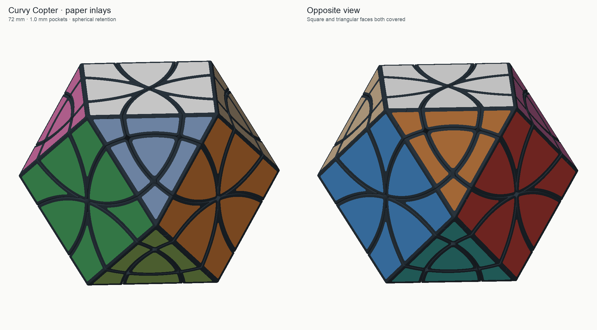
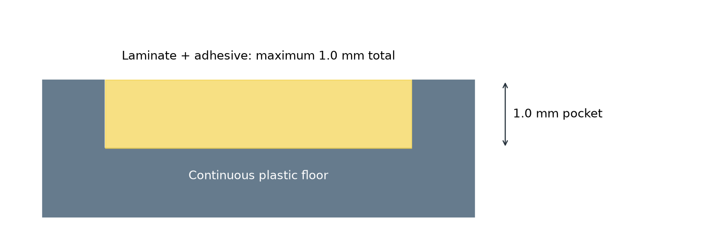

# Curvy Copter cuboctahedron — 1 mm inlay pockets, v4.2

A 72 mm natural cuboctahedron with twelve corner-turning axes, ordinary 180° turns and Curvy Copter jumbling. The square and triangular faces have **1.00 mm deep pockets** for laminated-paper inlays. Small keyed plugs cover the screws and complete the four pocket floors and dividing walls on each screwed piece.

**Reprint all 56 exterior parts and recut the inlays. Reuse the existing core and hardware.** The deeper pockets have newly sized contours to preserve their walls and backing. The old 0.5 mm cutting outlines do not match this version. The overall puzzle size, spherical retaining mechanism, screw seats, plug keys and print orientations are unchanged.

## Print files

[Download the full print package or the small A4 cutting-file ZIP](https://github.com/lukacslacko/wonkycube/releases/tag/curvy-copter-cuboctahedron-v4.2).

| STL in `stl/puzzle/` | Quantity |
| --- | ---: |
| `axial-center-print-12.stl` | 12 |
| `petal-print-24.stl` | 24 |
| `floating-corner-print-8.stl` | 8 |
| `keyed-plug-print-12.stl` | 12 |
| `core.stl` | 1, only if a new core is needed |

The four geometry-only 3MFs in `plates/` contain the full exterior quantities, without the optional core. They contain no printer profile. The optional `start-here/fit-check.3mf` contains a real center and plug plus small fit coupons; these are additional test pieces.

Keep the supplied orientations: inward radial direction down for the mechanism pieces, flat keyed bottom down for plugs. Use the PLA settings that worked for your P1S and 0.4 mm nozzle, with 0.16 or 0.20 mm layers. Centers, petals and floating corners need supports; auto/tree supports from the build plate and a brim for small feet are appropriate starting settings. Remove support marks from the tracks. Start with **0.00 mm XY contour compensation**.

Hardware: **12 DIN912 M3 × 20 mm screws, 12 DIN985 M3 nuts and 12 washers of 9 mm outer diameter × 1 mm thickness**. The included core is byte-identical to the spherical-retention core, with 5.25 mm terminal nut seats and a wider tapered entrance. The 3.6 mm screw bores, 9.6 mm washer/driver access and 3 mm clearance above the screw heads are preserved.

## Pockets and cutting sheets

- **1.00 mm pocket depth**, measured perpendicular to each exterior face.
- **At least 1.2 mm between adjacent face pockets** and **1.2 mm backing** in the continuous solid before the central plug joint is separated.
- Nominal perimeter border: **0.8 mm**. Pocket corner radius: **0.45 mm**. The complete R2 radial fillets, including their formerly hooked half-arcs, are preserved.
- **104 inlays**: eight on each of six square faces, seven on each of eight triangular faces. Cut each of the 14 face sheets once.
- The default cutting contours match the new pockets exactly, with **zero contour reduction**. The optional `easy-` set is inset 0.05 mm per side; use it only if a material/cutter fit test needs that allowance.
- Every SVG, DXF and DWG sheet has a separate **210 × 297 mm A4 rectangle**. For DXF imports, select everything, lock the aspect ratio and set the selection to **210 mm wide × 297 mm high**. Then ungroup if necessary and **delete the outer rectangle before cutting**.

See [the cutting instructions](inlays/README.md), [sheet dimensions](inlays/sheet-dimensions.csv) and [face map](images/face-map.png). The files contain cut contours and one removable A4 frame; they do not contain labels to be cut. Genuine DWGs use AutoCAD 2000/AC1015 encoding.

Laminated paper plus adhesive must be no thicker than **1 mm**. Thinner paper will sit recessed, with the higher walls providing guidance. Use a thin adhesive layer as needed. Each inlay stays on one moving puzzle piece; the four on a screwed piece may bridge its base/plug joint. Remove those inlays before servicing the screw.

## Assembly

1. Reuse the assembled core and its captive nuts, or press nuts into the optional new core.
2. Interlock the floating shell with screwed pieces absent or loose, using the same rotational hooking as the spherical-retention build. See [NEIGHBORS.md](NEIGHBORS.md) for solved adjacencies.
3. Fit washers and screws, complete the shell, and adjust tension. Check ordinary turns and jumbling before applying paper.
4. Insert the keyed plugs from outside. Their 12 × 10.4 mm rounded rectangular keys prevent free rotation and allow the intended 180° symmetry. Side clearance is 0.12 mm with small local friction ribs.
5. Scale, cut and fit the new inlays using the face map. Keep adhesive out of moving seams.

## Checks and physical evidence

The spherical-retention mechanism has been printed and assembled successfully. The owner printed the 0.5 mm pocket version and reported insufficient guidance/location for the inlays. **This 1 mm revision has not yet been physically printed.**

Checks reload the delivered STLs and cover closed connected solids, preservation of the mechanism inside R35, unchanged core, full pocket wall/backing envelopes, actual pocket-floor support, plug insertion/removal and keying, washer/driver access, 0.16/0.20 mm layer connectivity, retention using only the actual feet, all twelve ordinary turns, the five-step jumbling demonstration and a 48-step legal jumbling walk. The collision envelope includes inlays filling the entire 1 mm depth. Both halves of the repaired radial fillets are inspected separately.

Cutting-file checks cover all 30 sheets: 104 exact face inlays, optional fit variants, calibration/test outlines, one independent A4 rectangle per sheet and genuine DWG round trips. Reports are in `reports/`. These are finite rigid-geometry and file checks, not physical measurements of friction, printing roughness, adhesive, paper or press-fit force. Assembly of the shell inherits the successful mechanism's physical evidence; outside plug insertion is checked separately.

## Source and license

MIT license. [Build instructions](source/BUILD.md) describe the self-contained source and its SHA-verified baseline meshes. `manifest.json` records printable parts and transforms; `SHA256SUMS` identifies the delivered files.
